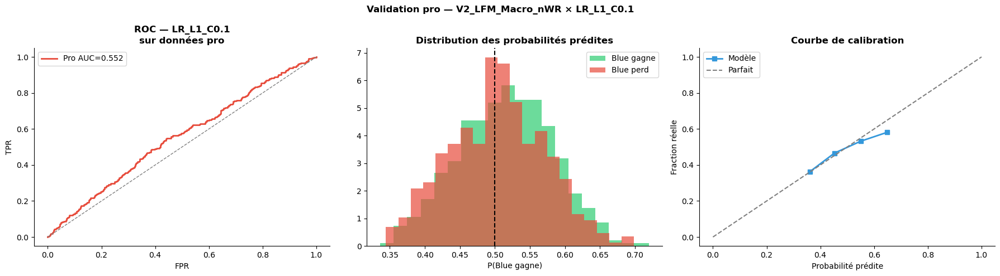
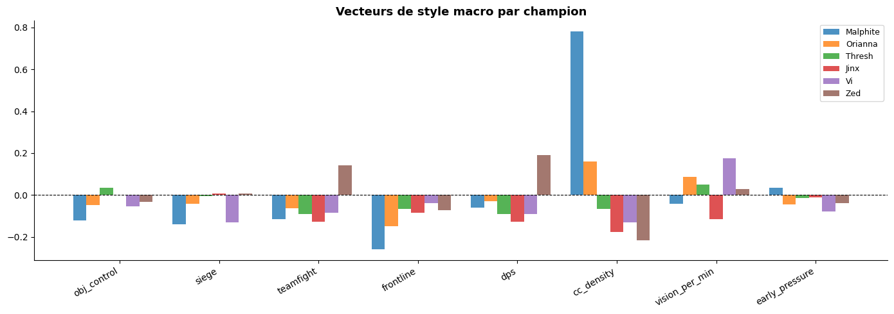
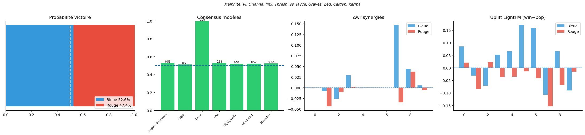

# Prédire le vainqueur d'une partie de League of Legends à partir de la draft

Peut-on prédire quelle équipe va gagner **avant même le début de la partie**, uniquement à partir des 10 champions choisis ? Ce notebook construit des variables qui décrivent la composition de chaque équipe, compare plusieurs modèles sur des parties classées de haut niveau, puis teste si ce qu'ils ont appris **se généralise au jeu professionnel**.

> Projet d'études réalisé en équipe à l'INSA Toulouse. Ce dépôt présente le modèle de prédiction (v7) que j'ai développé dans le cadre de ce projet.



## Données

- **16 402 parties classées** Master+ (Master, Grandmaster, Challenger) sur le serveur EUW, collectées via l'API Riot Games, soit 171 champions.
- **979 parties professionnelles** de la saison 2026 (patchs 16.01 et 16.02, source : Oracle's Elixir), utilisées uniquement pour la validation finale.
- Répartition entraînement / test : 80 % / 20 % (13 121 / 3 281 parties).

## Variables construites (308 au total)

- **Taux de victoire, synergies et counters** : statistiques par champion, par paire alliée (13 651 paires) et par affrontement (27 409 paires), estimées uniquement sur l'ensemble d'entraînement.
- **Embeddings de champions** : représentation vectorielle de chaque champion (32 dimensions) issue de la co-occurrence des champions dans les équipes gagnantes ou perdantes (filtrage collaboratif, LightFM). *Note : dans cette version du notebook, le bloc d'import de LightFM a été modifié et remplacé par un repli simplifié (embeddings basés sur la popularité).*
- **Vecteurs de « style macro »** : un profil par champion sur 8 axes (contrôle des objectifs, siège, teamfight, frontline, dégâts, densité de contrôle, vision, pression en début de partie), calculé à partir des statistiques d'équipe et normalisé par minute. La couverture de chaque axe par une équipe mesure l'équilibre de la composition.



Quatre jeux de variables (V1 à V4) ont été comparés pour mesurer l'apport de chaque famille : avec ou sans taux de victoire, style brut ou couverture fonctionnelle.

## Résultats

**Parties classées (jeu de test) : AUC ≈ 0,571.** Sur les 9 classifieurs comparés, les modèles linéaires régularisés (LDA, Ridge, régression logistique L1/L2, ElasticNet) ressortent nettement devant Random Forest (0,51 à 0,56) et le réseau de neurones MLP (0,53 à 0,56), qui surapprennent.

**Généralisation aux parties professionnelles : AUC = 0,553, accuracy = 53,7 %** (régression logistique L1). Le signal appris sur la soloQ se transfère partiellement au jeu pro, et la précision augmente avec la confiance du modèle :

| Confiance du modèle | Parties | Accuracy |
|---|---|---|
| 0 à 10 % | 498 | 51,6 % |
| 10 à 20 % | 339 | 54,6 % |
| 20 à 30 % | 126 | 58,7 % |
| 30 à 40 % | 15 | 60,0 % |

**À retenir.** La draft seule n'explique qu'une petite partie de l'issue d'une partie : le niveau des joueurs et l'exécution comptent bien davantage. Un AUC de 0,55 à 0,57 correspond à ce qu'on peut attendre de ce problème. L'intérêt du projet tient surtout à la construction des variables et au test de généralisation sur une population différente.

## Autres pistes explorées (rapport final)

Le rapport final du projet, *Draft Outcome Prediction in League of Legends: A Hybrid Pipeline Combining Style Vectors, Collaborative Filtering, and Graph Neural Networks*, rédigé en anglais, documente aussi les approches testées puis écartées de cette version du notebook :

- **Graph Attention Network (GATv2)** : chaque draft est représentée par un graphe de 10 nœuds (un par champion, 44 variables par nœud), avec des arêtes qui encodent les synergies au sein d'une équipe et les counters entre équipes. Résultat : AUC = 0,5465, en dessous de tous les modèles linéaires. Avec environ 8 500 drafts, le volume de données ne suffit pas pour qu'un modèle aussi complexe exploite les interactions.
- **Clustering K-means des champions** : 4 archétypes identifiés sur les vecteurs de style (méthode du coude). Aucun ne s'écarte significativement de 50 % de victoires : l'archétype décrit la structure du jeu, il ne prédit pas le résultat à lui seul.
- **Intégration des parties pro à l'entraînement** : quatre stratégies ont été testées, et aucune ne fait mieux que l'entraînement sur la soloQ seule. Les compositions pro (stratégie d'équipe, picks signature) suivent une distribution trop différente de celle de la soloQ.

| Stratégie | AUC |
|---|---|
| SoloQ seule (référence) | **0,5714** |
| Fusion directe | 0,5642 |
| Fusion pondérée (poids 5 sur les parties pro) | 0,5636 |
| Filtre sur les champions joués en pro | 0,5513 |
| Filtre + pondération | 0,5513 |

- **Nettoyage des données** : retirer Katarina, championne peu représentative du méta pro, fait gagner 0,008 d'AUC. Les noms de champions écrits différemment entre les deux sources (KaiSa, KhaZix, LeBlanc) ont aussi été harmonisés.

**Conclusion du rapport :** les modèles linéaires battent systématiquement les modèles non linéaires. Le signal de la draft est réel mais essentiellement additif, et il se transfère en partie au jeu professionnel sans réentraînement.

## Prédire une draft

```python
predict_winner(
    ["Malphite", "Vi", "Orianna", "Jinx", "Thresh"],   # équipe bleue
    ["Jayce", "Graves", "Zed", "Caitlyn", "Karma"],    # équipe rouge
)
```



## Reproduire

```bash
pip install -r requirements.txt
jupyter notebook lol_draft_predictor.ipynb
```

Les fichiers de données (`lol_dataset_challenger_grandmaster_clean.csv`, `pro_games_2026_patch1_2.csv`) ne sont pas versionnés à cause de leur taille. Placez-les à côté du notebook. Sans la librairie LightFM, le notebook se replie sur des embeddings simplifiés.

## Stack

Python · pandas · scikit-learn · LightFM · SciPy · matplotlib / seaborn
